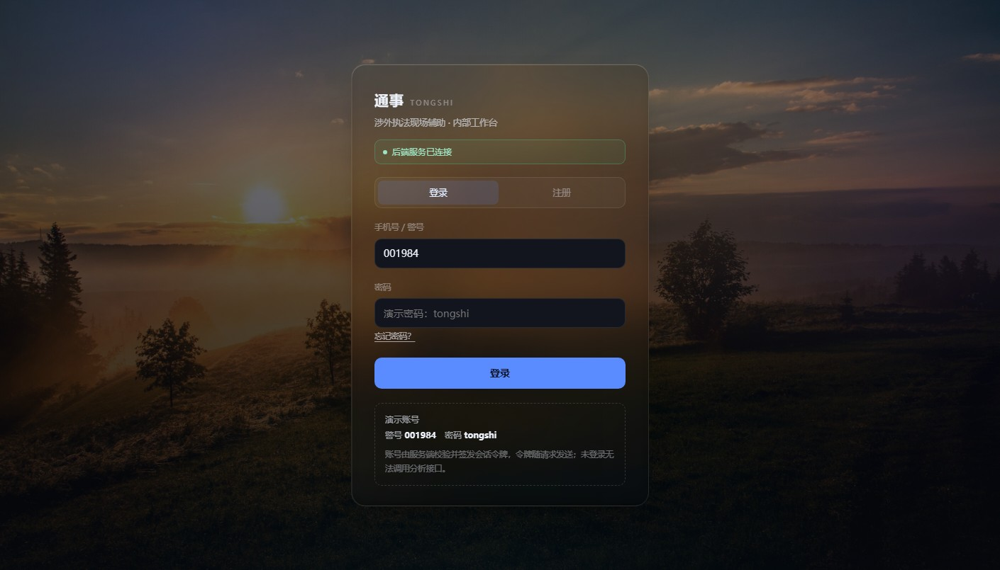
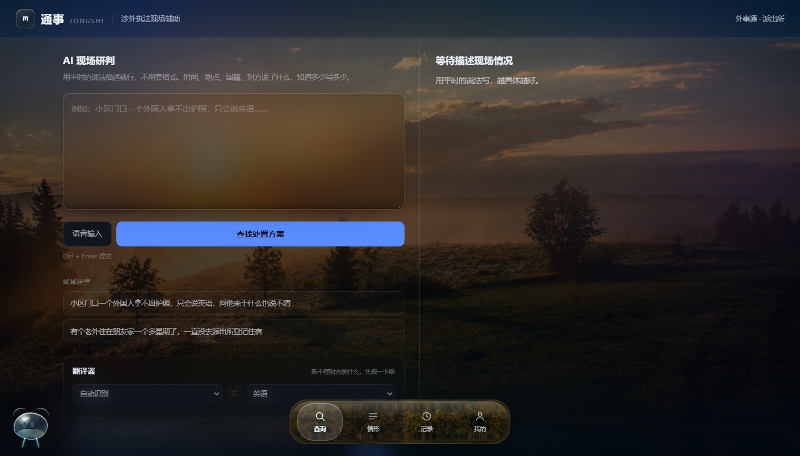
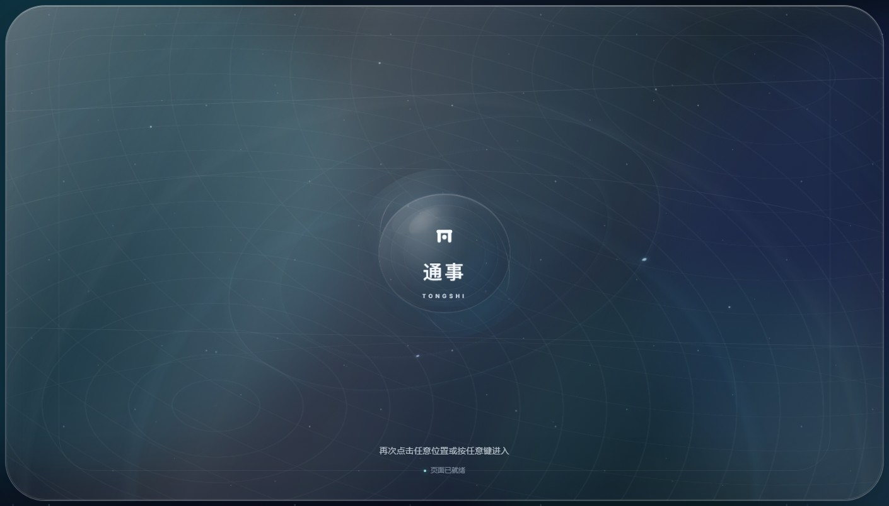

# 通事 TONGSHI · 涉外执法现场助手

[](https://github.com/yinyongshuiyiguoqi/tongshi/actions/workflows/ci.yml)

传智杯参赛作品。民警登录后，用自己的话描述现场情况：和情形库典型表述达到 95% 相似度的，
直接给出人工核定的处置流程、依据和话术；其余交给 Agent 自主研判。

## 界面预览

| 登录 | 工作台 |
| --- | --- |
|  |  |



## 运行

双击 `start.bat`，或者：

```bash
npm install
npm run agent    # 后端 Agent，http://localhost:8787（可选；不配 .env.local 时走本地法条库/模板）
npm run dev      # 前端 http://localhost:5180
npm run build    # 产物在 dist/
```

> **语音识别是可选能力**：它依赖服务端的 `sherpa-onnx`、`zhconv` 和系统 `ffmpeg`，**没有写进 `package.json`**；只跑网页和文字功能不需要安装。安装步骤见「部署 → SenseVoice 语音识别」。

## 现在能做什么

- **登录**：支持手机号注册/登录，也保留演示警号；会话存在 localStorage，刷新不掉
- **输入**：自由文本，中文口语、错别字都能用；服务端 SenseVoice 语音识别，统一输出简体中文
- **匹配**：情形库只保留 5 类高频标准流程；输入与典型表述达到 95% 相似度才调出预设
- **输出**：处置流程、研判意见、法律依据、现场话术、注意事项、待确认事项
- **兜底**：没到阈值的描述交给 Agent，先检索现行法条，再基于检索结果自主研判
- **降级**：模型不可用时回落到法规检索模板，标注参考性质，不硬给结论

## 两段式：高相似度走库，其余走模型

只靠情形库，覆盖面有限；只靠大模型，它会编条号和数额，执法场景里不能用。所以分两段：

| 情况 | 走哪条路 | 特征 |
| --- | --- | --- |
| 与典型表述 ≥95% | 情形库标准答案 | 流程、依据、话术都是人工核定过的，可追溯，断网可用 |
| 其余 | Agent 自主研判 + 法规检索 | 覆盖任意描述，结构化输出，依据经过条号校验 |

两段共用同一份法规要点。模型那一路的提示词明确禁止编造法名、条号、数额，依据不足时要求直接说明
需要补充什么。这样既保证「任意问题都有回应」，又不至于把编出来的东西当依据用。

## 匹配是怎么做的

`src/lib/match.ts` 只做一件事：判断这次描述是不是「几乎就是情形库里的某一类」。

1. **典型表述相似度**（主项）：每条情形带若干 `examples`，用字符二元组 Dice 相似度取最高值；
   称呼、常见说法（老外/外籍人员、没带/未带）先做同义归一
2. **关键词命中**（辅助）：只负责把分数稍微抬高，不能单独把一个模糊描述推过阈值

阈值 `HIT_THRESHOLD = 0.95`。达到才渲染情形库结果卡；没达到时 `active` 为空，
页面改走 Agent 研判，并标注「未命中情形库 · Agent 研判」。

现在的结果全在浏览器里算，断网也能跑；接向量检索时把相似度换成 embedding 即可，接口不变。

实测：

| 输入 | 结果 |
| --- | --- |
| 小区门口一个外国人拿不出护照，只会说英语，问他来干什么也说不清 | 命中「外籍人员无法出示证件」，100% |
| 老外没带护照，也拿不出居留证件 | 同上（同义归一后 100%） |
| 老外喝醉了在店里砸东西 | 未达阈值，交由 Agent 研判 |
| 外国人在餐厅打工，拿的是旅游签证，没有工作许可 | 命中「外籍人员非法就业」，100% |

## 加一条情形

只需要改 `src/data/cases.ts`，往 `CASES` 里加一个对象：

```ts
{
  id: 'c-xxx',
  title: '情形名称',
  severity: '低' | '中' | '高',
  scene: '一句完整的描述',
  examples: ['典型表述1', '典型表述2'],       // 达到 95% 相似度才命中，必填
  keywords: [{ w: '口语说法', weight: 3 }],   // 3 强相关，1 弱相关
  steps: ['第一步', '第二步'],
  provisionIds: ['p-crj71'],                  // 指向 PROVISIONS 里的条目
  scripts: [{ zh: '中文话术', en: '英文话术' }],
  risk: '注意事项',
  brief: '一句研判要点，不要重复流程',
  followUp: '还需要确认什么',
}
```

情形库只保留高频标准流程；新增前先确认它是否值得占用一个预设位。界面不用动，
情形数量、分类列表、匹配全部自动跟上。

## 架构：前端 + Agent 服务

```
浏览器 (React)  ──POST /api/analyse──▶  Node Agent (server/agent.mjs)
                                          │
                                          ├─▶ 法条检索：本地法条库 / 元典 law_vector_search
                                          └─▶ 大模型（DeepSeek / Claude / 通义，可切）
```

Agent 循环在服务端跑，前端只负责渲染。这样做有三个好处：key 不进 bundle；
MCP 或第三方接口不受浏览器 CORS 限制；中间过程（检索了什么、命中几条）可以推回前端展示，
评委看得见。

跑起来需要两个进程，`start.bat` 会自动开：

```bash
npm run agent   # 8787，Agent 服务
npm run dev     # 5180，前端（已配 /api 代理）
```

服务端读的是**不带 VITE_ 前缀**的变量（`.env.local`）：

```
LAW_API_KEY=...
LLM_API_KEY=...
LLM_BASE=https://api.deepseek.com
LLM_MODEL=deepseek-chat
```

`LAW_API_KEY` 可以留空。留空时检索走**本地法条库**（`src/data/statutes.json`），
条文原文逐条对照中国人大网、国家移民管理局公布的现行文本核过，前端情形库和它共用同一个
id，改条号只改一处。两个 key 都不配也能跑：检索走本地库、回答走模板，链路本身是通的。

### 为什么不用 Hermes / OpenClaw 当外壳

这两个是本地 Agent 运行时，适合自己用；比赛要求作品是公网可访问的 Web 应用，套上去之后
就没有「在线演示」了。同样的 Agent 逻辑用 90 行 Node 写在 `server/agent.mjs` 里，
评委打开网址就能用，也更容易写进技术文档。

## 法规检索：本地库 / 元典

情形库没命中时，光靠模型容易编条款，所以服务端会先检索现行法条，再让模型只基于检索结果作答。

**默认走本地法条库**：前端高频库 `src/data/statutes.json` 收 17 条，服务端另有全量语料：民法典 1260 条、刑法 451 条（第199条已删去）、国际法核心条约 243 条，共 1971 条；全量语料只在服务端加载，不进前端 bundle。
每条形文都是原文，注明现行有效、效力级别和出处链接。检索按关键词命中排序，
搜索范围限定在这一份语料内——模型只能在核过的条文里说话，编不出内容。

要扩到全库检索，填 `.env.local` 里的 `LAW_API_KEY` 即可，走元典开放平台
（open.chineselaw.com）的 `law_vector_search`，按自然语言检索、只取「现行有效」的条目。
两种来源的返回结构相同，前端不用改；`/api/health` 的 `law` 字段会显示当前是
`local` 还是 `api`。

**这条路径的取舍写进了技术文档**：本地库保证确定性和可核验，代价是覆盖面有限；
元典补覆盖面，代价是依赖外部服务与积分。演示时默认走本地库，断网也不会塌。

## 接真模型

模型跑在服务端，key 不进 bundle。配好 `.env.local` 里的 `LLM_BASE` / `LLM_API_KEY` /
`LLM_MODEL` 之后，两条路径都会用到模型：

| 输入 | 去向 | 模型做什么 |
|---|---|---|
| 命中情形库 | 结果卡 | 「AI 研判」区块：结合民警原话，指出这一次该抓的重点、容易出错的地方 |
| 没命中 | Agent 研判 | 服务端先检索本地法条，再让模型在检索结果范围内作答 |

模型失败或没配 key 时，命中路径回落到情形库里的 `brief` 字段，未命中路径走模板输出，
链路不会断。

验证联通性：

```bash
npm run check     # 打一次真实请求，401/402/429 各有中文提示
```

接口按 OpenAI 兼容格式，DeepSeek、智谱、通义、Moonshot 都能直接用。

**安全**：仓库只提交 `.env.example`，真 key 放 `.env.local`（已在 `.gitignore`），
服务端读取，不进前端产物。`src/lib/ai.ts`、`src/lib/legal.ts` 是早期的浏览器直连兜底，
只在后端起不来时启用，正式部署可以删掉。

## 目录

```
server/
  agent.mjs            Agent 循环 + 登录鉴权 + 法条检索
src/
  App.tsx              会话切换（登录 / 工作台）
  components/
    Login.tsx          登录页
    Workbench.tsx      输入区与结果区
    ResultCard.tsx     匹配结果卡（复制中/英文、打印）
    CaseBrief.tsx      命中情形后的 AI 研判（流式、可重生成）
    AiFallback.tsx     未命中时的 Agent 研判
    Empty.tsx          空状态：流程说明、情形清单、最近记录
  data/statutes.json   法条库：原文 + 关键词 + 出处（前后端共用）
  data/cases.ts        情形库（依据 id 指向 statutes.json）
  lib/match.ts         匹配算法
  lib/agent.ts         Agent 客户端（SSE）
  lib/legal.ts         元典检索（浏览器直连兜底）
  lib/ai.ts            模型直连（浏览器兜底）
  lib/session.ts       登录态与令牌
  lib/history.ts       最近处置记录
  styles.css           全部样式（含打印样式）
```

## 登录

不是摆设。账号写在服务端（`server/agent.mjs`），前端只拿到 HMAC 签名的会话令牌，
12 小时过期；`/api/analyse` 会校验令牌，没有令牌直接 401。

演示账号：警号 `001984` / 密码 `tongshi`（另有 100234、100235、100236 三个）。

### 手机号注册

登录页可以直接用手机号注册：

- 手机号作为登录账号
- 密码至少 8 位，服务端只保存 scrypt 哈希与随机盐
- 注册成功后自动登录
- 用户数据保存在服务端 `data/users.json`
- 当前版本未接入短信验证码；正式环境应接阿里云短信或统一身份认证
- 新增注册用户不进入演示账号列表，按手机号独立登录

数据备份/迁移时，除了 `.env.local`，还要一起迁移 `data/users.json`、`data/agent-configs.json` 和 `data/feedback.jsonl`。

正式环境应换成内网统一认证，会话密钥走 `SESSION_SECRET` 环境变量。

## 界面

底部是一条液态玻璃导航（查询 / 情形 / 记录 / 我的），按住可以横向拖动，指示条跟手走，
松手按拖到的位置落位。导航本身用 `apple-liquid-glass-webgl` 渲染，不是 CSS 毛玻璃。

背景是三层叠起来的：自然风光图层（三套手绘 SVG 场景：晨雾山脊、暮色海面、深林薄雾）、
一层暗色渐变保证文字可读、再加一层很淡的极光。卡片是半透明加背景模糊，背景会从卡片底下透出来。

背景在「我的」里切换，也可以上传自己的照片（4MB 以内），选择存在本机 localStorage。

## 展示页

`showcase.html` 是单独一个入口，用苹果购买页那套语言讲作品：大标题、灰底圆角块、
底部吸附条。录演示视频和答辩时用，不影响应用本身。

```
http://localhost:5180/showcase.html
```

纯 HTML + CSS，没有脚本，构建后是独立页面。

## 打印与导出

结果卡上有“打印 / 存为 PDF”。用的是浏览器原生打印，配了一套打印样式：只输出结果卡，
隐藏输入区、导航和按钮。在打印对话框里选“另存为 PDF”即可归档。

## 部署

单进程就能跑：`server/agent.mjs` 同时提供接口和 `dist` 里的前端。
构建之后直接启动，浏览器打开 `http://服务器地址:8787` 即可，不需要另配 Nginx。

```bash
npm run build
SESSION_SECRET=<随机长串> node server/agent.mjs
```

**要固定域名、放到云服务器上，按 [`部署指北.md`](./部署指北.md) 走**，
里面有服务器/域名的选购、打包上传、systemd 开机自启、Caddy 自动 HTTPS 的完整步骤。
配套文件在 `deploy/`：

| 文件 | 用途 |
|---|---|
| `pack.ps1` | 本地打包成 `tongshi-deploy.tar.gz`，只含运行所需文件 |
| `tongshi.service` | systemd 单元，失败的自动重启、开机自启 |
| `Caddyfile` | 反向代理 + 自动申请证书，SSE 不缓冲 |

两个必须设置的环境变量：

- `SESSION_SECRET`：不设就用默认值，任何人都能伪造令牌。`NODE_ENV=production` 时
  检测到默认值会**直接拒绝启动**。
- `LLM_API_KEY`：不设则回答走模板，能演示但看不到 AI。

`PORT` 默认 8787，可用 `AGENT_PORT` 覆盖。静态文件只认 `dist` 下的真实路径，
不做 SPA 通配回落，所以多页入口（`/` 与 `/showcase.html`）都要构建后访问。

**开发模式**是另一回事：`npm run dev` 起 Vite（5180），`/api` 由 Vite 代理到 8787，
两边都要开着，`start.bat` 会一起拉起来。

### SenseVoice 语音识别

语音识别默认使用 SenseVoice（sherpa-onnx int8），中文准确率和简体输出都优于 tiny Whisper。
模型文件较大，不放进源码包，部署时放到：

```text
/opt/tongshi/models/sensevoice/model.int8.onnx
/opt/tongshi/models/sensevoice/tokens.txt
```

依赖：

```bash
python3 -m pip install sherpa-onnx zhconv
# ffmpeg 用于把 webm/mp4 转成 16k 单声道 PCM
```

`server/asr_server.py` 会优先加载 SenseVoice；模型缺失或加载失败时回退 faster-whisper tiny。
识别结果统一经过 `zhconv` 转简体，并修正“居留证件”等高频误识别。

## 安全边界

| 措施 | 现状 |
|---|---|
| 登录校验 | 账号在服务端，HMAC 签名令牌，12 小时过期，`/api/analyse`、`/api/brief` 均校验 |
| 请求体 | 超过 64KB 直接 413 |
| 限流 | 登录 20 次/分，分析接口 40 次/分，按 IP 计 |
| 令牌存储 | 浏览器 localStorage |
| CORS | `*`，方便本地调试；正式部署建议收紧到自己的域名 |

令牌放 localStorage 是因为没有配 HttpOnly Cookie 的会话服务，XSS 下可被读取；
作为比赛演示可以接受，README 里也写明这套认证是演示用途，不是生产级统一认证。

## 已知限制

- 匹配是字面匹配，"对方不肯配合"这种抽象表述容易漏
- 情形之间没有冲突消解，输入同时命中多类时只按分数排序
- 语音输入使用服务端 SenseVoice，模型缺失时回退 faster-whisper；Safari 录音权限表现较弱
- 情形库 10 条，覆盖常见涉外警情，扩到 30 条左右匹配质量会有明显提升
- AI 研判只会提示「引用未在检索结果中」，不做自动改写
